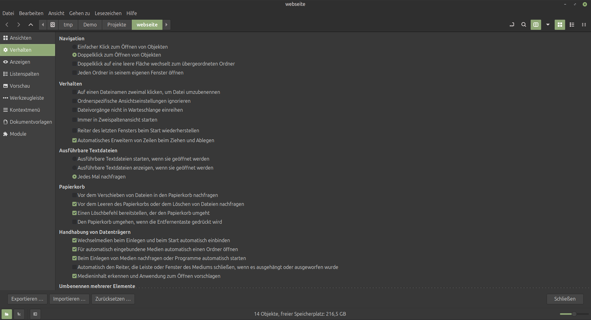
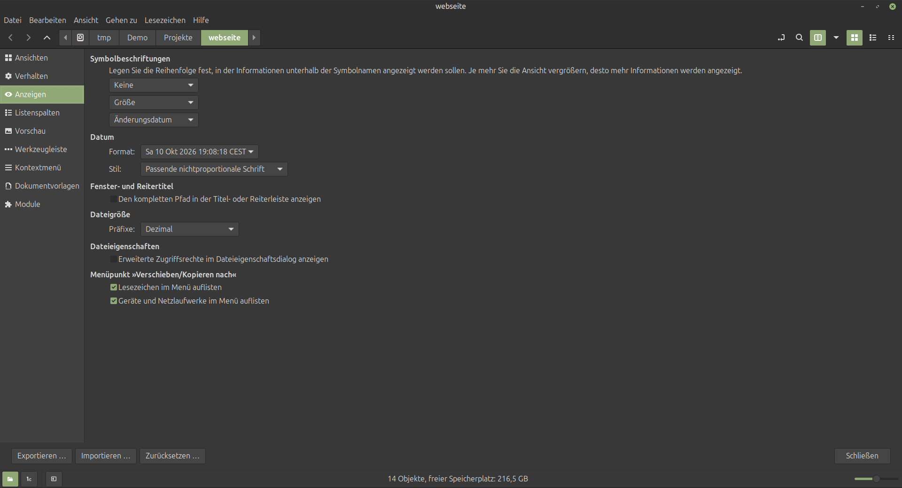
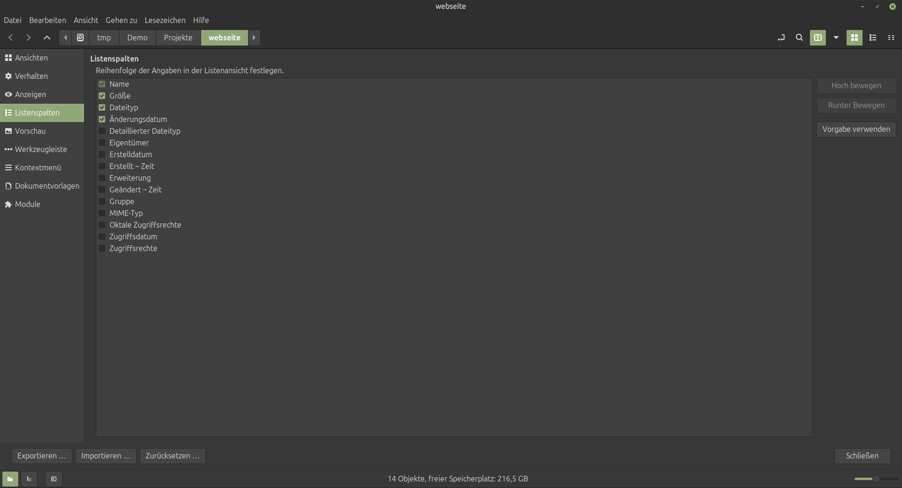
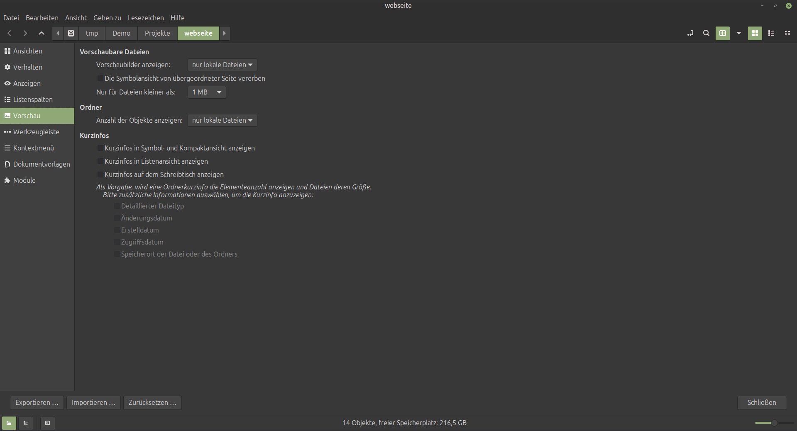
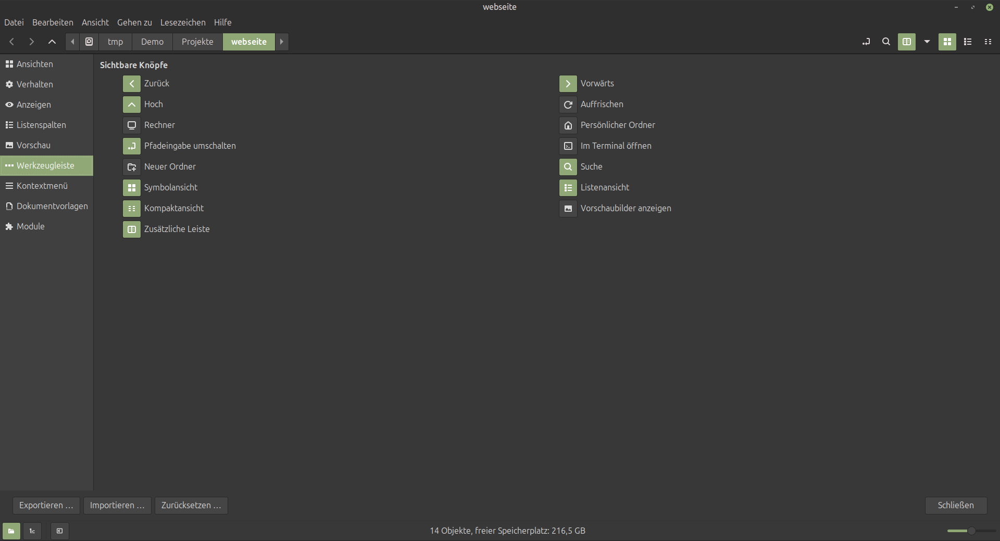
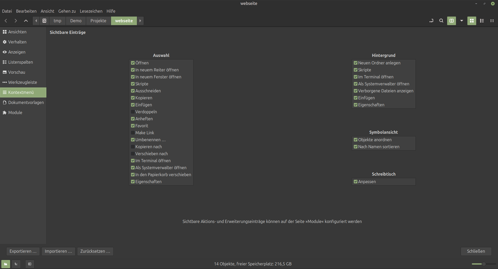
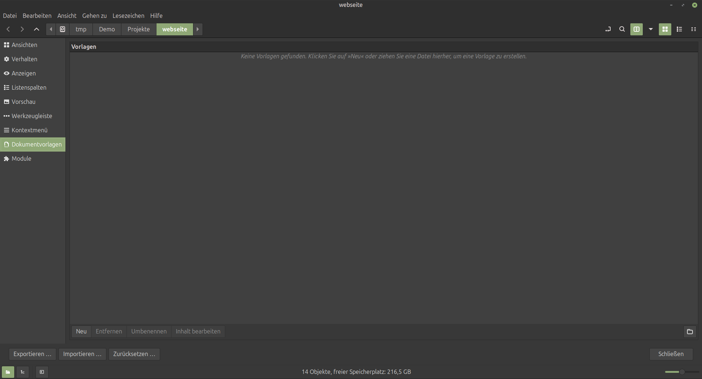
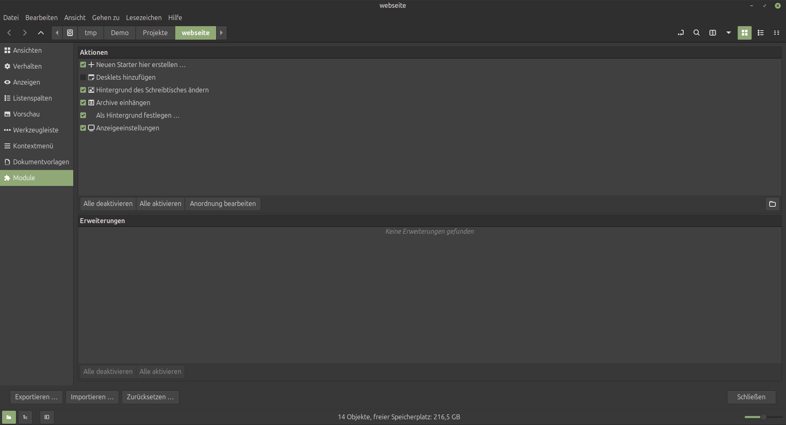
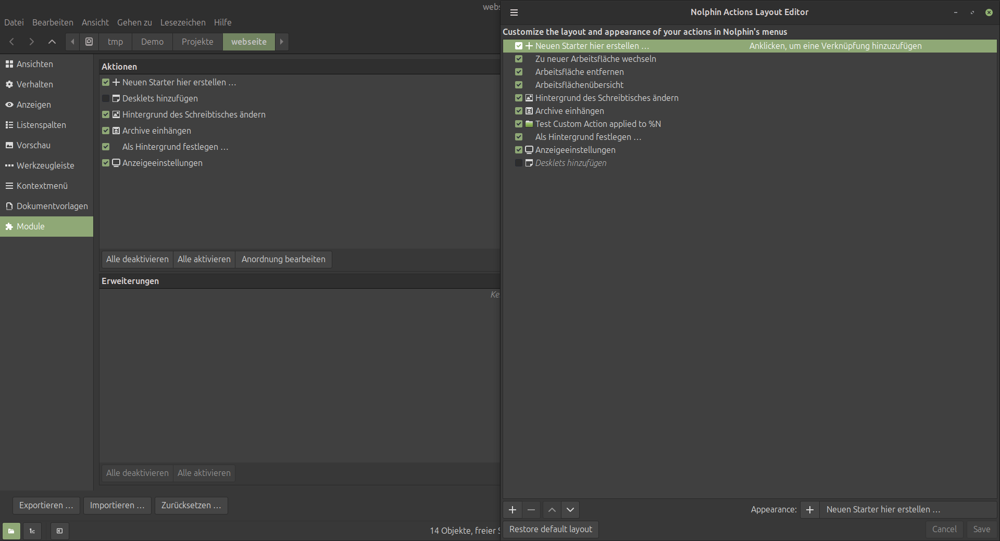

[Startseite](../README.md) | [← Funktionen im Detail](funktionen.md) | [Andere Desktops: XFCE und MATE →](andere-desktops.md)

# Einstellungen und Anpassung

Ansichten, Verhalten, Anzeige, Listenspalten, Vorschau, Werkzeugleiste, Kontextmenüs, Dokumentvorlagen und Module haben jeweils eine eigene Einstellungsseite. Unten stehen **Exportieren …**, **Importieren …** und **Zurücksetzen …** für alle Einstellungen.

> **Bekannt:** Einzelne Texte (zum Beispiel im Layout-Editor und in manchen Einstellungsseiten) sind noch englisch.

| | |
| --- | --- |
| **Verhalten**  | **Anzeige**  |
| **Listenspalten**  | **Vorschau**  |
| **Werkzeugleiste**  | **Kontextmenüs**  |
| **Dokumentvorlagen**  | **Plugins und Aktionen**  |

Reihenfolge und Aussehen der Aktionen in den Menüs bearbeitest du im Layout-Editor:

---

[Weiter: Andere Desktops: XFCE und MATE →](andere-desktops.md)
