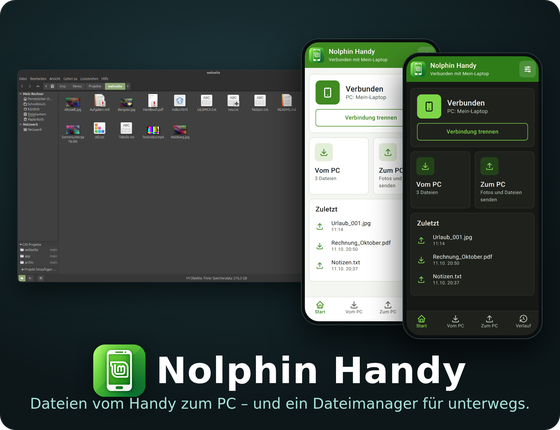

[← Handy-Austausch: Analyse](handy-austausch-analyse.md) | [Startseite](../README.md)

# Handy-Austausch: Schnittstelle (Version 2)

Diese Schnittstelle bietet Nolphin am PC an, und die Android-App verwendet sie. Sie ist **nur verschlüsselt** (HTTPS) erreichbar; es gibt keinen Weg über den Browser des Handys. Quelle der Wahrheit ist `src/nolphin-phone-server.c`.

> **Optionale Erweiterung:** Die Android-App **[Nolphin Handy](https://github.com/kaysiebke-cell/nolphin-handy)** ist ein eigenes Projekt (reines Android-Framework, keine Bibliotheken). Nolphin braucht sie nur für den Handy-Austausch; alles andere in Nolphin läuft ohne sie. Die App verbindet sich per QR-Code, lädt Dateien vom PC, sendet Dateien und ganze Ordner an den PC und ist zugleich ein Dateimanager fürs Handy.
>
> [](https://github.com/kaysiebke-cell/nolphin-handy)

## Grundlagen

- HTTP/1.1 **über TLS** (TLS 1.2 oder 1.3). Das Zertifikat ist **selbst erstellt** (EC P-256, mit `openssl`, gültig 3 Tage) und wird **pro Schlüssel neu erzeugt**. Die App akzeptiert nur genau dieses Zertifikat: Sein Fingerabdruck steht im Link (`f`). Fremde Zertifikate, auch solche von sonst vertrauenswürdigen Stellen, lehnt sie ab. Wer Klartext (`http://`) an den Port schickt, bekommt **keine Antwort**. Siehe [Sicherheit](handy-austausch-analyse.md#sicherheit).
- Fehlt `openssl` oder die TLS-Unterstützung von GLib (`glib-networking`), startet der Austausch nicht und nennt den Grund. Es gibt **keinen Rückfall auf unverschlüsselt**.
- Der Server bindet an **eine** IPv4-Adresse des PCs (privates Netz). Der Port wird bei jedem Start vom System gewählt.
- Jede Anfrage braucht den Schlüssel als Abfrageparameter `t`. Ohne gültigen Schlüssel antwortet der Server mit `403`. Es gibt bewusst keine Sperre nach falschen Schlüsseln: Bei 128 Bit ist Raten aussichtslos, und eine Sperre könnte das eigene Handy aussperren.
- Jede Antwort schließt die Verbindung (`Connection: close`). Antworten haben `Cache-Control: no-store` und `X-Content-Type-Options: nosniff`.
- Nur Verbindungen aus Loopback-, privaten und Link-Local-Netzen werden bearbeitet.
- Anfragen mit `Transfer-Encoding: chunked` werden bei `POST` mit `501` abgelehnt; Uploads brauchen `Content-Length`.

## Verbindungslink und QR-Code, Format Version 2

```
nolphin://<IPv4>:<Port>/?t=<Schlüssel>&v=2&f=<Fingerabdruck>
```

Das ist der Link im QR-Code und im Eingabefeld des Panels. Die App versteht außerdem `https://<IPv4>:<Port>/?t=…&v=2&f=…` und die ältere Form `nolphin://connect?host=<IPv4>:<Port>&t=…&v=2&f=…`.

| Feld | Bedeutung | Regeln |
| ---- | --------- | ------ |
| `<IPv4>` | Adresse des PCs | genau vier Zahlen 0 bis 255; privat (`10/8`, `172.16/12`, `192.168/16`), Link-Local (`169.254/16`) oder Loopback (`127/8`); Hostnamen und IPv6 werden abgelehnt |
| `<Port>` | Port des Servers | 1 bis 65535 |
| `t` | Schlüssel | genau 32 Zeichen `0-9a-f` (128 Bit aus `/dev/urandom`) |
| `v` | Version des Links | `2`; jeden anderen Wert und das Fehlen lehnt die App ab |
| `f` | Fingerabdruck des Zertifikats | genau 22 Zeichen `A-Za-z0-9_-`: die ersten 16 Bytes (128 Bit) von SHA-256 über das Zertifikat (DER), base64url ohne `=` |

- **Links der Version 1** (`http://…`, ohne Fingerabdruck) lehnt die App mit einer deutlichen Meldung ab. Alte Apps verbinden sich mit einem neuen Nolphin nicht (und umgekehrt): Beide müssen auf dem gleichen Stand sein.
- Die **Ablaufzeit `e`** steht nicht mehr im Link: Er würde sonst nicht mehr in den QR-Code passen (der Encoder fasst höchstens 106 Zeichen, der längste Link hat 96). Der Server erzwingt den Ablauf ohnehin (siehe `403`). Die App liest ein `e` noch, falls eines da ist.
- Der Link darf höchstens 300 Zeichen lang sein.
- Das Schema `nolphin://` sorgt dafür, dass **kein Browser** den Link öffnet. Gescannt wird mit dem **Scanner der Handy-App** (eigene Kamera, eigener QR-Leser), der sofort verbindet. Der Scanner von Xiaomi (am echten Handy geprüft) zeigt den Link nur als Text oder öffnet `https://`-Links im Browser und gibt nichts an die App zurück; wer so scannt, kopiert den Text, und die App liest ihn dann aus der Zwischenablage (siehe unten). Ein Link von außen (Kamera-App, Browser) verbindet erst nach einer Bestätigung in der App.

## Lebensdauer des Schlüssels

- Ein Schlüssel gilt höchstens **12 Stunden** (`TOKEN_LIFETIME_DEFAULT`). Für Tests lässt sich das mit der Umgebungsvariable `NOLPHIN_PHONE_TOKEN_LIFETIME` (Sekunden) verkürzen.
- **Widerruf:** „Neuen QR-Code erzeugen“ im Panel (oder `nolphin_phone_server_rotate_token ()`) erzeugt einen neuen Schlüssel **und ein neues Zertifikat** mit neuer Ablaufzeit. Der alte Code ist in jeder Hinsicht wertlos.
- **Merken über einen Neustart:** Adresse, Port, Schlüssel **und Zertifikat samt privatem Schlüssel** stehen in `~/.config/nolphin/phone-session` (Rechte 0600, Ordner 0700), solange der Schlüssel gilt. Schlüssel und Zertifikat werden nur **zusammen** wiederaufgenommen; fehlt eines oder ist es kaputt, entsteht beides neu. Startet Nolphin den Austausch erneut, nimmt es sie wieder auf; das Handy verbindet sich dann von selbst, ohne neuen QR-Code. Ist der Port belegt, die Adresse eine andere oder der Schlüssel abgelaufen, entsteht ein neuer Schlüssel. Sitzungen aus einer Version vor der Verschlüsselung (ohne Zertifikat) werden nicht übernommen.
- **Beenden** (Knopf oder Menü) und „Neuen QR-Code erzeugen“ widerrufen die gemerkte Sitzung; die Datei wird gelöscht beziehungsweise ersetzt. Schließen von Nolphin oder die Selbstabschaltung widerrufen sie nicht.
- **Selbstabschaltung:** 15 Minuten ohne gültige Anfrage beenden den Server. Eine verbundene App hält ihn durch `GET /wait` am Leben.

## Wege

### `GET /info?t=…`

Prüft Schlüssel und Gegenstelle.

```json
{"app":"nolphin","api":1,"name":"mein-laptop","expires":1700000000,"maxUpload":2147483648,"share":true}
```

`api` ist die Version der Schnittstelle (hier 1), `expires` die Ablaufzeit des Schlüssels, `maxUpload` die größte erlaubte Datei in Bytes, `share` sagt, ob ein Ausgangsordner (`~/Handy`) vorhanden ist, `folders`, ob `/up` das Feld `d` (Unterordner) versteht.

### `GET /ls?t=…`

Dateien im Ausgangsordner `~/Handy` (nur Dateien, keine Unterordner) als JSON-Liste (höchstens 500, ohne versteckte Dateien, ohne Verknüpfungen, ohne Dateien, die in den letzten 3 Sekunden geändert wurden):

```json
[{"n":"Größe Übung ä ö ü ß.jpg","s":4096},{"n":"Bericht (Entwurf) #2 & Co 100%.pdf","s":9000}]
```

`n` ist der Dateiname (UTF-8), `s` die Größe in Bytes.

### `GET /wait?t=…&v=<Stand>`

Wartepunkt für die App. Antwortet, sobald sich die Liste gegenüber dem Stand `v` ändert, **spätestens nach 20 Sekunden**. Ohne `v` antwortet er sofort.

```json
{"v":"<md5 der Liste>","files":[{"n":"…","s":123}]}
```

Die App schickt den zuletzt erhaltenen `v` mit. Jede Anfrage zählt als Aktivität (gegen die Selbstabschaltung).

### `GET /dl?t=…&n=<Name>`

Lädt eine Datei aus dem Ausgangsordner. `n` ist der Dateiname, prozentkodiert (UTF-8). Antwort `200` mit `Content-Length`, `Content-Type: application/octet-stream` und `Content-Disposition: attachment`. Der Name muss **genau** so im Ordner stehen (keine Pfade, keine Änderung durch die Bereinigung, nicht mit Punkt beginnend), sonst `404`. Verknüpfungen und Nicht-Dateien liefern `404`. Der Inhalt wird in Stücken von 64 KiB gesendet, nicht im Ganzen geladen.

### `GET /dir?t=…&r=home&p=<Unterordner>` und `GET /dl?t=…&r=home&p=<Unterordner>&n=<Name>` (persönlicher Ordner)

Mit `r=home` gelten `/dir` und `/dl` für den **persönlichen Ordner** (`~`, für Tests `NOLPHIN_PHONE_HOME`) statt für „Zum Handy“, nur lesend. Ohne `r` bleibt alles wie bisher. Jeder andere Wert von `r` liefert `404`. Es gelten dieselben Schutzregeln wie für den Ausgangsordner: Schlüssel, privates Netz, nur Namen ohne `..` und ohne führenden Punkt (versteckte Dateien und Ordner wie `.ssh` sind weder sichtbar noch ladbar), nur echte Ordner und normale Dateien, keine Symbolischen Verknüpfungen (`O_NOFOLLOW`). `GET /info` meldet die Fähigkeit mit `"home":true`; Apps prüfen das, weil ältere Versionen `r` ignorieren würden.

### `POST /up?t=…&n=<Name>[&d=<Ordner>]`

Lädt eine Datei in den Eingangsordner „Vom Handy“ hoch. Der Körper sind die Rohdaten der Datei, `Content-Length` ist Pflicht.

Der Name wird bereinigt: nur der letzte Pfadteil (`/` und `\` trennen), Steuerzeichen und Richtungsumkehr-Zeichen entfernt, führende Punkte und Leerzeichen entfernt, höchstens 200 Bytes (an einer Zeichengrenze gekürzt), leer wird zu „Datei“. Die Datei wird zuerst in eine Temporärdatei geschrieben und dann unter dem Namen abgelegt. **Es wird nie überschrieben**: Gibt es den Namen, wird `Name (1).ext`, `Name (2).ext` usw. verwendet. Bei Abbruch wird die Temporärdatei gelöscht.

**Ordner (`d`, optional):** Mit `d=Ordner1/Unter` kommt die Datei in diesen Unterordner des Eingangsordners. Die Ordner werden bei Bedarf angelegt, bestehende werden weiterverwendet (Dateien darin werden nie überschrieben, siehe oben). `/` trennt die Ebenen (höchstens 32). Jede Ebene muss ein unveränderter, bereinigter Name sein und darf nicht mit einem Punkt beginnen. Sonst gibt es `400` und es wird nichts abgelegt. Ordner, die als Link oder Datei vorhanden sind, werden nicht benutzt. Ob der PC das kann, steht in `/info` als `"folders":true`; fehlt das Feld, schickt die App einen Ordner als ZIP.

Antwort bei Erfolg: `200` mit `{"ok":true,"name":"<endgültiger Name>"}`.

### `POST /mkdir?t=…&d=<Ordner>`

Legt einen (leeren) Unterordner im Eingangsordner an, mit denselben Regeln für `d` wie bei `/up`. Ein bestehender Ordner ist kein Fehler. Antwort: `200` mit `{"ok":true}`, bei ungültigem oder fehlendem Namen `400`. Die App nutzt das für leere Ordner; ob der PC es kann, steht in `/info` als `"folders":true`.

### `GET /apk?t=…`

Liefert die Handy-App (`application/vnd.android.package-archive`) über die verschlüsselte Verbindung, falls sie installiert ist. Die Erstinstallation läuft **nicht** mehr über den Browser, sondern von Hand (zum Beispiel per USB oder über eine Datei); Aktualisierungen holt die App selbst. Suchreihenfolge: Umgebungsvariable `NOLPHIN_PHONE_APK`, `~/.local/share/nolphin/phone/nolphin-handy.apk`, `<datadir>/nolphin/phone/`, die Systemdatenverzeichnisse. Sonst `404`.

### `GET /` (entfernt)

Es gibt **keine Seite für den Browser des Handys** mehr. `GET /` antwortet auch mit Schlüssel `404`.

## Fehlercodes

| Code | Wo | Bedeutung |
| ---- | -- | --------- |
| 400 | alle | kaputte Anfrage, Kopfzeilen über 16 KiB |
| 403 | alle | Schlüssel fehlt, falsch oder widerrufen (Text „Der Link ist ungültig oder wurde widerrufen.“) oder **abgelaufen** (Text „Der Link ist abgelaufen.“) |
| 404 | `/dl`, `/apk`, `/`, sonstige | Datei nicht vorhanden oder nicht erlaubt, unbekannter Weg (auch `/`) |
| 400 | `/up`, `/mkdir` | ungültiger oder fehlender Ordnername in `d` |
| 411 | `/up` | `Content-Length` fehlt |
| 413 | `/up` | Datei größer als 2 GiB |
| 500 | `/up` | Schreibfehler, Datei kann nicht abgelegt werden |
| 501 | `/up` | `Transfer-Encoding: chunked` wird nicht unterstützt |
| 507 | `/up` | kein Speicherplatz am PC |

Bricht die Verbindung mitten im Upload ab, antwortet der Server nicht mehr (es gibt niemanden mehr); die Teildatei wird entfernt. Scheitert der TLS-Handshake (Klartext, falsches Protokoll, abgelehntes Zertifikat), kommt keine HTTP-Antwort.

## Grenzen im Server

Kopfzeilen 16 KiB, 30 s Zeitgrenze je Verbindung, 8 gleichzeitige Arbeitsthreads (ein `GET /wait` belegt einen davon bis zu 20 s), Upload 2 GiB, Liste 500 Einträge.

## Verhalten der App

- **Verbinden:** Link prüfen (siehe Format, Version 2 mit Fingerabdruck), `GET /info` über TLS mit dem festgelegten Zertifikat aufrufen, bei Erfolg Adresse, Schlüssel und Fingerabdruck speichern. Eine gespeicherte Verbindung ohne Fingerabdruck (aus einer älteren App) gilt nicht mehr. Antwortet eine ältere Nolphin-Version mit `404` auf `/info`, prüft die App stattdessen `GET /ls`. Meldungen: Schlüssel abgelaufen, Schlüssel abgelehnt (Neustart oder neuer Code), **Zertifikat passt nicht zum QR-Code** (neuer Code am PC, oder jemand im Netz gibt sich als der PC aus; es wird nichts gesendet), keine Verbindung, kein Nolphin, andere Version der Schnittstelle, Adresse nicht privat. Die App verbietet unverschlüsselten Verkehr auch auf Systemebene (`usesCleartextTraffic=false`).
- **PC → Handy:** Hintergrunddienst mit `GET /wait`. Neue Dateien (Name und Größe noch nicht bekannt) werden mit `GET /dl` nach `Download/Nolphin` geladen, in Stücken von 64 KiB, mit Fortschritt und Abbruch. Beim allerersten Verbinden werden vorhandene Dateien nicht geladen. Wird abgebrochen, lädt die App die Datei nicht von selbst erneut.
- **Scannen:** Der Knopf „QR-Code scannen und verbinden“ (und die Verknüpfung am App-Symbol) öffnet die Kamera der App; der eigene QR-Leser liest den Code (auch schräg gehalten, mit Spiegelung und teilweise verdeckt: die Fehlerkorrektur des QR-Codes entscheidet) und verbindet sofort. Liegt ein **Nolphin-Link in der Zwischenablage**, der höchstens 2 Minuten alt ist, bietet die App beim Öffnen an, sich damit zu verbinden („Mit diesem PC verbinden?“); sonst gibt es den Knopf „Link aus der Zwischenablage einfügen“. Links von außen (Kamera-App, Browser, andere App) fragen immer erst nach.
- **Handy → PC:** Teilen-Menü („Nolphin (PC)“) oder Dateiauswahl in der App. Die Datei wird zunächst im Zwischenspeicher der App abgelegt (so ist die Länge immer genau), dann mit `POST /up` und fester Länge gesendet, in Stücken von 64 KiB, mit Fortschritt und Abbruch.
- **Aktualisieren:** Die App holt im Hintergrund `GET /apk` (höchstens alle 30 Minuten) und vergleicht die Versionsnummer der Datei mit der eigenen. Ist sie höher, zeigt die Startseite „Neue Version“ und „Aktualisieren“; die Installation läuft über den Paketinstaller von Android (gleiche Signatur, Daten und Verbindung bleiben). Beim ersten Mal fragt Android nach der Erlaubnis „Apps installieren“ (`REQUEST_INSTALL_PACKAGES`).
- **Zertifikat passt nicht beim Warten:** Statusmeldung „Schlüssel ungültig: Das Zertifikat des PCs passt nicht zum QR-Code. QR-Code am PC neu scannen“, neuer Versuch erst nach 15 Sekunden.
- **Schlüssel ungültig (`403`) beim Warten:** Statusmeldung „Schlüssel abgelaufen: QR-Code am PC neu scannen“, die App versucht es weiter.
- **Verbindung weg:** Statusmeldung „PC nicht erreichbar, neuer Versuch …“, alle fünf Sekunden ein neuer Versuch; Teildateien werden gelöscht.

## Beispiele

```bash
# Nur zum Ausprobieren am eigenen PC: -k prüft das Zertifikat NICHT (die App prüft den Fingerabdruck).
URL='https://192.168.1.10:40000'; T='0123456789abcdef0123456789abcdef'
curl -k "$URL/info?t=$T"                                 # Prüfen
curl -k "$URL/ls?t=$T"                                   # Liste
curl -k -o foto.jpg "$URL/dl?t=$T&n=foto.jpg"            # Laden
curl -k -X POST --data-binary @foto.jpg "$URL/up?t=$T&n=foto.jpg"   # Senden
```
